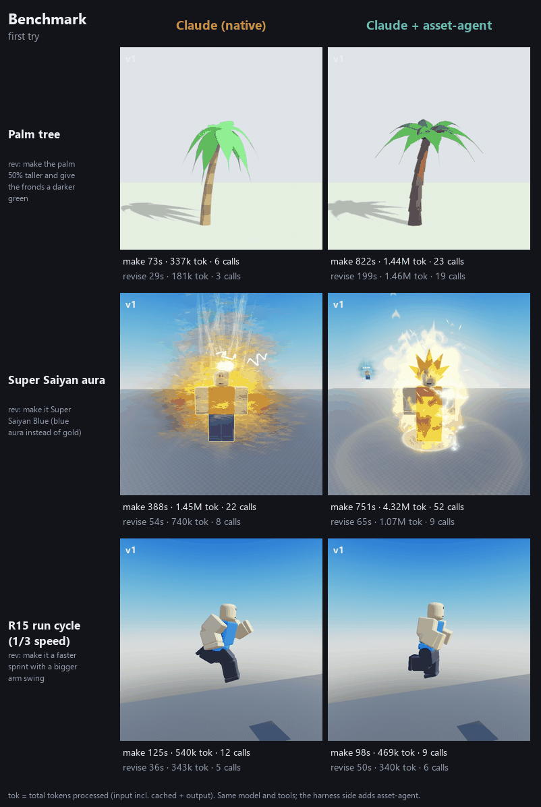

# 3D-Asset-Agent

A low-token 3D asset harness for Claude and other LLM agents. It builds on [Blender MCP](https://github.com/ahujasid/blender-mcp) and AI text/image-to-3D generators to produce game-ready assets, mainly for Roblox.

- **Low token cost.** Tools return one-line summaries, images are opt-in, and the server reports diffs instead of full scene dumps.
- **Modular assets.** Geometry, topology, UVs, surface, finish and collision are separate layers, so a revision rebuilds only what changed.
- **Validated output.** Each asset is checked against a polycount budget and for manifold geometry, UVs and scale, then exported as FBX/GLB for Roblox or other engines.

See [docs/PLAN.md](docs/PLAN.md) for the full plan.

## Benchmark



The benchmark covers three tasks (a palm tree, a Super Saiyan aura and an R15 run cycle), with one revision each.
For now, native Claude is faster and cheaper. The generator, the missing aura and animation tools, and pipeline
bugs cost the harness more than its cheap revisions save. Full numbers, method and the fix list are in
[docs/BENCHMARK.md](docs/BENCHMARK.md).

## Quick start (free, no API keys)

```python
from asset_agent import make_asset, Asset

# text -> image (FLUX.1-schnell) -> shape (Hunyuan3D-2) on free Hugging Face Spaces,
# then decimate to the Roblox budget, UV, texture, validate and export
print(make_asset("assets/chest", prompt="a wooden treasure chest, low poly"))
print(make_asset("assets/chest_flat", prompt="a wooden treasure chest, low poly", style="flat", color=[0.7, 0.45, 0.25]))

a = Asset("assets/chest")
a.revise("finish", tint=[1, 0.8, 0.8])      # re-exports only
a.revise("topology", part="main", target_tris=2000)
```

- `style="project"` paints the generated reference image onto the front; `style="flat"` is one colour × ambient occlusion, and recolouring is a finish-only change.
- Works anonymously. Set `HF_TOKEN` (a free Hugging Face account) for more daily GPU time.
- Generations are cached in `library/cache/`, so the same request is never run twice.

## MCP server
`.mcp.json` registers `asset-agent` (run with `uv run asset-agent-mcp`). It has 8 tools, about 1k tokens of definitions:
- `make_asset`, `import_mesh`
- `revise`, `rollback`, `history`
- `validate`
- `preview` (opt-in 256px 4-view tile)
- `library`

## Your own GPU (optional)
With an NVIDIA GPU (6 GB+ of VRAM), shape generation runs on your own machine: unlimited and private. The GPU can also be in another machine, such as a home desktop serving your laptop.
```
uv run asset-agent setup            # on the GPU machine: installs Hunyuan3D-2 for your card
uv run asset-agent serve            # this machine only
uv run asset-agent serve --remote   # or let other machines connect; prints a key
uv run asset-agent connect http://<gpu-machine>:8080 --key <key>   # on the other machine
uv run asset-agent status           # what is installed and which backend is in use
```
`backend="auto"`, the default, uses your server when it's up and the free Spaces when it isn't. See [docs/GPU_SERVER.md](docs/GPU_SERVER.md).
